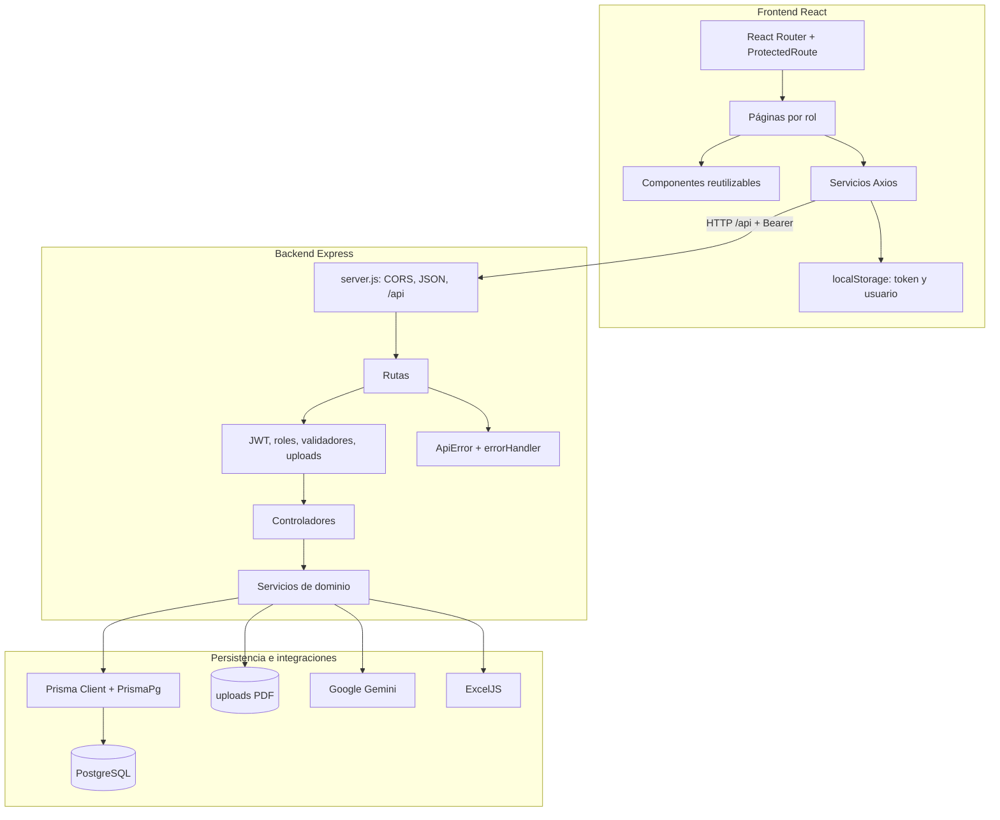
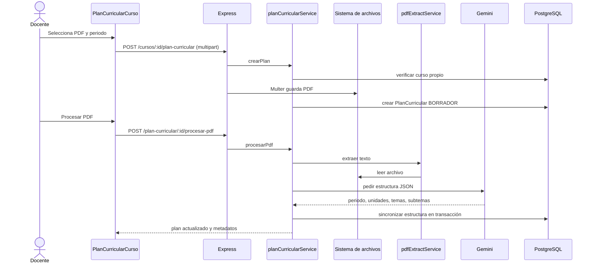
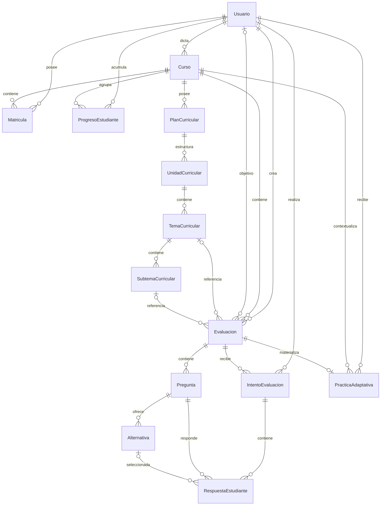

# Arquitectura y base de datos de EvaluaIA

## 1. Vista de componentes

## 2. Frontend

`main.jsx` monta la SPA y `App.jsx` delega en `routes/index.jsx`. Hay rutas públicas (`/`, `/login`, `/registro`) y grupos protegidos por `ProtectedRoute` para DOCENTE/ESTUDIANTE dentro de `AppLayout`. El layout integra Navbar y Sidebar.

Las páginas mantienen estado con hooks; no hay store global. Los servicios encapsulan Axios. El interceptor request añade JWT; el response normaliza mensajes y limpia sesión en 401. Las páginas de docente cubren dashboard, cursos, detalle, plan curricular, evaluación, resultados y perfil. Las de estudiante cubren dashboard, cursos/temas, evaluación, resultados, progreso y perfil.

## 3. Backend

### Capas

1. **Rutas:** método, path, JWT, rol, validación y upload.
2. **Controladores:** parsean identificadores, llaman servicios y producen códigos JSON.
3. **Servicios:** propiedad, matrícula, reglas educativas, transacciones e integraciones.
4. **Prisma:** queries y relaciones PostgreSQL.
5. **Middleware:** JWT, roles, archivos, 404 y errores.

`asyncHandler` evita `try/catch` repetitivo y entrega rechazos a `errorHandler`. `ApiError` representa 400/401/403/404/409/503. El handler registra método/ruta/mensaje y devuelve `{ok:false,error}`.

### Comunicación

JSON se usa para casi toda la API. PDF y Excel usan `multipart/form-data`; la plantilla se devuelve como MIME OpenXML. La IA recibe/produce estructuras internas JSON. No hay WebSocket, cola, caché ni jobs.

## 4. Secuencia: plan curricular desde PDF

El orden exacto entre guardado Multer y la llamada del controlador implica que el archivo ya está escrito cuando el servicio valida propiedad. Un intento no autorizado puede dejar archivo huérfano si el servicio falla antes de limpieza; requiere prueba y manejo explícito.

## 5. Modelo entidad-relación

## 6. Diccionario de entidades

### Usuario

Identidad común. `id` serial, `correo` único, `contrasena` hash, `rol`; perfil opcional: foto, teléfono, institución y biografía. Un docente se relaciona con cursos/evaluaciones; un estudiante con matrículas, intentos, progreso, prácticas y evaluaciones objetivo. El esquema no restringe que solo DOCENTE sea `docenteId` o solo ESTUDIANTE sea `estudianteId`; lo controla el servicio.

### Curso

Nombre, grado, sección, descripción y docente. Relaciona matrícula, evaluaciones, progreso, prácticas y planes. El borrado en cascada desde curso afecta varias entidades dependientes, pero la relación al docente es restrictiva.

### Matricula

Entidad puente estudiante-curso con fecha. `@@unique([estudianteId, cursoId])`. Curso usa cascada; usuario, comportamiento restrictivo predeterminado.

### Evaluacion

Título, tema/subtema, dificultad, fecha límite, estado, indicador adaptativo, alumno objetivo y referencias curriculares opcionales. Pertenece a curso y docente. Curso elimina en cascada; referencias curriculares usan `SetNull`. Puede tener preguntas, intentos y una práctica.

### Pregunta y Alternativa

Pregunta contiene enunciado, tipo, dificultad, tema, solución textual opcional y puntaje float. Alternativa tiene texto y flag correcto. Ambas caen en cascada desde evaluación/pregunta. No existe restricción DB de exactamente una alternativa correcta.

### IntentoEvaluacion

Fechas, puntaje, porcentaje, nivel, estado y retroalimentación JSON. Une estudiante/evaluación. `@@unique([estudianteId,evaluacionId])` materializa un solo intento. Las respuestas caen en cascada al eliminar intento.

### RespuestaEstudiante

Texto o alternativa, corrección, puntaje y feedback. Une intento/pregunta/alternativa. Falta `@@unique([intentoId,preguntaId])`; tampoco hay check que alternativa pertenezca a pregunta, aunque el servicio lo valida.

### ProgresoEstudiante

Tema, nivel, dominio, recomendación y `updatedAt`; único por alumno/curso/tema. El `upsert` reemplaza el valor temático al procesar una nueva evaluación.

### PracticaAdaptativa

Tema, dificultad, estado, motivo JSON, cantidad y timestamps. Une alumno, curso y evaluación. `evaluacionId @unique` establece uno a uno. La evaluación asociada se publica y apunta al alumno objetivo.

### Jerarquía curricular

`PlanCurricular` guarda archivo, ruta, periodo y estado. Contiene unidades ordenadas; cada unidad temas ordenados/estado; cada tema subtemas. El esquema no impone unicidad de `orden`, título o plan por curso. Las eliminaciones internas son cascada.

## 7. Integridad y migraciones

Migraciones encontradas:

1. `20260622060842_init`: núcleo de usuarios, cursos, evaluaciones, intentos y progreso.
2. `20260622194808_add_perfil_fields`: perfil.
3. `20260622210000_add_retroalimentacion_ia`: JSON IA.
4. `20260622220000_add_practicas_adaptativas`: prácticas/objetivo.
5. `20260622230000_unique_intento_por_evaluacion`: intento único.
6. `20260626200445_add_plan_curricular`: plan y jerarquía.

No se conectó a DB para confirmar cuáles están aplicadas. Debe verificarse que la migración curricular incluya `temaCurricularId` y `subtemaCurricularId` de `Evaluacion`; una divergencia esquema/migración causaría fallos en despliegue limpio.

Riesgos:

- Respuesta duplicada bajo concurrencia.
- Correo único sensible a collation/caso de PostgreSQL, mientras importación compara insensible al caso.
- Puntajes/porcentajes no tienen checks DB de rango o positividad.
- Estado y relaciones de rol dependen de aplicación.
- Borrar evaluación elimina intentos/resultados; no hay política de conservación.
- Borrar curso puede borrar amplio historial por cascada.
- Ruta absoluta de PDF acopla registro al contenedor/host.

## 8. Infraestructura

Compose contiene:

- PostgreSQL 16 Alpine con volumen y healthcheck.
- Backend Node 22 Alpine, dependencia del healthcheck DB, migración/seed en entrypoint y puerto 3000.
- Frontend multi-stage: Node compila y Nginx 1.27 sirve puerto 80, expuesto como 8080.

Nginx resuelve SPA con `try_files` y gzip. No proxyfica `/api`: `VITE_API_URL` queda compilada en el bundle y el navegador llama directamente al backend. CORS debe incluir el origen frontend. No hay TLS, headers CSP/HSTS, límite de request en Nginx, balanceo ni observabilidad.

## 9. Variables de entorno identificadas

| Variable | Uso |
|---|---|
| `DATABASE_URL` | PostgreSQL/Prisma |
| `JWT_SECRET` | Firma JWT; sensible |
| `JWT_EXPIRES_IN` | Duración token |
| `PORT` | Puerto API |
| `CORS_ORIGIN` | Orígenes permitidos separados por coma |
| `VITE_API_URL` | URL API compilada en frontend |
| `GEMINI_API_KEY` | Credencial externa; sensible |
| `GEMINI_MODEL` | Modelo principal |
| `GEMINI_FALLBACK_MODELS` | Lista de fallback |
| `GEMINI_RETRY_MAX` | Reintentos |
| `GEMINI_RETRY_BASE_MS` | Espera base |
| `PLAN_CURRICULAR_MAX_MB` | Máximo PDF |
| `PDF_MIN_TEXT_CHARS` | Texto mínimo |
| `PDF_IA_MAX_CHARS` | Texto máximo enviado |
| `RUN_SEED` | Seed al iniciar contenedor |
| `NODE_ENV` | Entorno/caché Prisma |

No deben compartirse valores reales. La clave `VITE_*` es pública en el bundle y nunca debe contener secretos.

## 10. Decisiones y límites arquitectónicos

- Monolito modular apropiado para tesis y despliegue pequeño.
- Estado local reduce complejidad, pero duplica cargas y reglas de presentación.
- Validación manual es legible, aunque puede divergir entre endpoints.
- IA está encapsulada y tiene fallback solo en prácticas; otras funciones dependen de disponibilidad externa.
- No hay repositorio separado: los servicios mezclan lógica y acceso Prisma.
- No hay contratos OpenAPI, tipos compartidos o TypeScript en lógica de aplicación.
- No hay pruebas que garanticen las fronteras entre capas.
