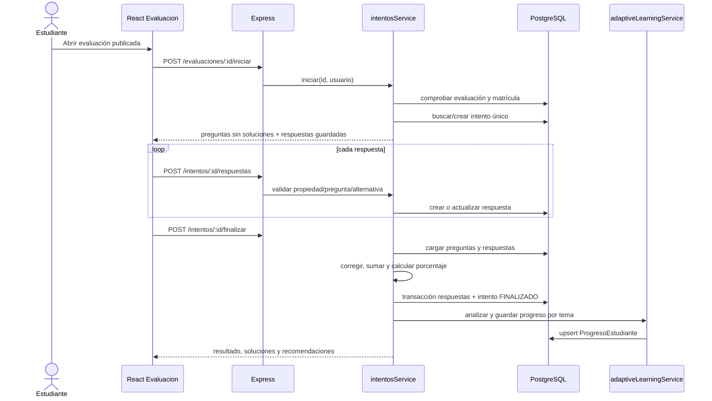

# Funcionalidades y flujos de EvaluaIA

## Convenciones

- **Implementada:** flujo respaldado por UI/API/servicio/persistencia, sin implicar prueba dinámica.
- **Parcial:** parte del objetivo existe, pero hay una carencia material.
- **Simulada:** responde con datos de prueba o fallback genérico.
- **No verificada:** depende de DB, archivos o servicio externo no ejecutado en esta auditoría.

## 1. Inventario funcional

| Funcionalidad | Rol | Frontend | Endpoint y backend | Datos/modelos | Estado y límites |
|---|---|---|---|---|---|
| Registro | Público | `Registro.jsx`, `authService.registro` | `POST /api/auth/registro` → `authController.registro` → `authService.registrar` | Usuario | Implementada; permite elegir DOCENTE públicamente |
| Login/logout | Ambos | `Login.jsx`, Navbar/Sidebar | `POST /api/auth/login`; logout solo local | Usuario/JWT | Implementada; sin revocación/refresh |
| Perfil propio | Ambos | Perfil docente/estudiante | `GET/PUT /api/perfil` → `perfilService` | Usuario + estadísticas | Implementada |
| Perfil de otro usuario | Ambos bajo reglas | Modal de detalle de curso | `GET /api/usuarios/:id/perfil` | Usuario, matrícula | Implementada; requiere probar cruces |
| Dashboard docente | Docente | `docente/Dashboard.jsx` | Principalmente `/cursos/mis-cursos` | Curso y conteos | Implementada |
| Cursos docente | Docente | `docente/Cursos.jsx` | `POST /cursos`, `GET /cursos/mis-cursos` | Curso | Implementada; no hay editar/eliminar curso |
| Detalle y analítica de curso | Docente | `DetalleCursoDocente.jsx` | `GET /cursos/:id`, `/resumen-estudiantes` | Curso, matrícula, intentos, progreso | Implementada; consultas potencialmente N+1 |
| Matrícula por correo | Docente | Cursos/detalle | `POST /cursos/:id/matriculas` | Usuario, Matricula | Implementada; cuenta debe existir |
| Baja de matrícula | Docente | Detalle | `DELETE /cursos/:id/matriculas/:estudianteId` | Matricula | Implementada; conserva intentos |
| Plantilla Excel | Docente | Detalle | `GET /cursos/:id/estudiantes/plantilla` | XLSX en memoria | Implementada, no verificada E2E |
| Importación Excel | Docente | Detalle | `POST /cursos/:id/estudiantes/importar` | Usuario, Matricula | Implementada, atómica; rechaza correos existentes |
| Plan curricular | Docente/estudiante | Plan curricular/temas | Endpoints curso, plan, unidad, tema y subtema | Plan y estructura | Implementada, no verificada E2E |
| PDF a estructura | Docente | `PlanCurricularCurso.jsx` | `POST /plan-curricular/:id/procesar-pdf` | Archivo, Plan, Gemini | Implementada; sin OCR, externa |
| Crear evaluación manual | Docente | `CrearEvaluacion.jsx` | `POST /evaluaciones` + preguntas | Evaluacion, Pregunta, Alternativa | Implementada |
| Generar preguntas IA | Docente | Crear evaluación | `POST /ia/generar-preguntas` | Gemini; borrador no persistido | Implementada, no verificada externamente |
| Publicar evaluación | Docente | Crear/detalle | `PUT /evaluaciones/:id/publicar` | Evaluacion | Implementada; no valida mínimo de preguntas en servicio revisado |
| Resultados docentes | Docente | `docente/Resultados.jsx` | Analítica por evaluación y resultados de intento | Intentos/respuestas | Implementada |
| Cursos/temas estudiante | Estudiante | Cursos, TemasDelCurso | `/cursos/mis-cursos`, planes y evaluaciones | Matrícula/plan/evaluación | Implementada; detalle curso tiene riesgo de privacidad |
| Resolver evaluación | Estudiante | `Evaluacion.jsx` | iniciar, guardar respuestas, finalizar | Intento/Respuesta | Implementada; fecha límite no bloquea |
| Resultados | Ambos autorizados | Resultados | `GET /intentos/:id/resultados` | Intento y respuestas | Implementada |
| Progreso | Estudiante | Progreso/perfil/dashboard | `GET /progreso/mi-progreso` | Progreso e intentos | Implementada |
| Retroalimentación IA | Ambos autorizados | Resultados | `POST /ia/generar-retroalimentacion` | Intento.retroalimentacionIA | Implementada, externa |
| Práctica adaptativa | Estudiante | Resultados/progreso | `POST /practicas-adaptativas/generar` | Evaluacion, PracticaAdaptativa | Parcial: adaptación determinista + IA/fallback simulado |
| Listado genérico de matrículas/preguntas | Público | Sin consumidor principal | `GET /matriculas`, `GET /preguntas` | Ninguno | Simulada, devuelve vacío |

## 2. Registro e inicio de sesión

### Registro

1. `Registro.jsx` reúne nombre, correo, contraseña y tipo de usuario.
2. `authService.registro` envía JSON a `POST /api/auth/registro`.
3. `validarRegistro` exige nombre, correo con formato, contraseña ≥6 y rol entre `DOCENTE/ESTUDIANTE`.
4. `authService.registrar` busca correo, genera hash bcrypt (10 rondas) y crea `Usuario`.
5. El controlador devuelve usuario sin `contrasena`; no inicia sesión automáticamente.

Casos: correo repetido produce 409; credencial inválida 400. Los correos no se normalizan consistentemente a minúsculas en el registro.

### Login

1. `Login.jsx` llama `authService.login`.
2. Backend busca correo y ejecuta `bcrypt.compare`.
3. Firma JWT con id/correo/rol y expiración.
4. Frontend guarda token y usuario en `localStorage` y navega al panel por rol.
5. Axios adjunta Bearer. Un 401 protegido limpia almacenamiento y redirige.

## 3. Gestión de perfiles

`GET /api/perfil` combina datos sanitizados y estadísticas según rol. `PUT` acepta los campos permitidos por `perfil.validator`: el servicio actualiza perfil y frontend sincroniza el usuario local. `GET /usuarios/:id/perfil` permite perfil propio; un docente solo puede consultar estudiantes matriculados en alguno de sus cursos. Debe probarse que un estudiante no vea perfiles ajenos.

## 4. Cursos y matrícula

### Curso

El docente completa nombre, grado, sección y descripción. La API valida obligatorios y crea `Curso.docenteId` con el usuario autenticado. `mis-cursos` devuelve cursos propios con conteos al docente, o cursos unidos por `Matricula` al estudiante.

No se encontraron endpoints para editar o eliminar un curso. El detalle docente incluye evaluaciones, estudiantes con estadísticas y rendimiento agregado.

### Matrícula individual

1. Docente introduce correo.
2. API verifica que el curso sea suyo.
3. Busca usuario y exige rol `ESTUDIANTE`.
4. Consulta restricción estudiante/curso y crea `Matricula`.
5. La baja elimina solo `Matricula`; el comentario declara conservar resultados históricos.

### Importación Excel

1. Docente descarga XLSX con hojas `Estudiantes` e `Instrucciones`.
2. Completa `nombres`, `correo`, `contrasena` (máximo 500 filas).
3. Multer recibe `.xlsx` en memoria, máximo 2 MB.
4. ExcelJS valida encabezados, celdas, correo, contraseña y duplicados internos.
5. Se buscan correos existentes sin distinguir mayúsculas.
6. Se calculan hashes y una transacción crea cada `Usuario(ESTUDIANTE)` y `Matricula`.
7. Cualquier error evita la importación completa; una condición única concurrente se traduce a 409.

Limitación: no permite matricular por Excel una cuenta ya registrada aunque aún no pertenezca al curso; lo trata como duplicado. Las contraseñas quedan visibles en la hoja antes de subirla, por lo que se requiere una política segura de distribución/cambio inicial.

## 5. Plan curricular y PDF

1. El docente propietario sube PDF y periodo por `POST /cursos/:id/plan-curricular`.
2. Multer guarda en disco, registra nombre saneado y ruta absoluta en `PlanCurricular` como borrador.
3. Al procesar, se verifica propiedad; si ya hay unidades se exige `confirmarReemplazo`.
4. `pdfExtractService` lee, valida tamaño, extrae texto, normaliza espacios, exige longitud mínima y trunca al máximo configurado.
5. `aiService.extraerEstructuraCurricularDeTexto` pide JSON con periodo, unidades, temas y subtemas.
6. El servicio valida la estructura, actualiza periodo y sincroniza la jerarquía en transacción.
7. Docente puede editar CRUD de unidades/temas/subtemas y publicar.
8. Estudiante matriculado solo lee planes publicados.

El procesamiento no usa OCR. El reemplazo borra la estructura anterior dentro de una transacción. El archivo original no tiene endpoint de descarga observado.

## 6. Evaluaciones y preguntas

### Creación manual o asistida

1. `CrearEvaluacion.jsx` selecciona curso, tema curricular opcional, título, dificultad, fecha y preguntas.
2. Puede solicitar un borrador a `/ia/generar-preguntas`; Gemini devuelve JSON validado. El borrador permanece en el navegador hasta guardarlo.
3. `POST /evaluaciones` verifica curso propio y referencias curriculares, crea evaluación (normalmente borrador).
4. Por cada pregunta se llama `POST /evaluaciones/:id/preguntas`.
5. Para opción múltiple se guardan alternativas y flags; verdadero/falso genera dos alternativas; respuesta corta guarda texto normalizado al corregir.
6. `PUT /:id/publicar` cambia estado a `PUBLICADA`.

No hay endpoint específico para editar/eliminar una pregunta ya creada. La edición general de evaluación puede modificar campos y estado. No se encontró regla que bloquee una evaluación sin preguntas ni mutaciones después de que existan intentos.

## 7. Flujo completo de evaluación

Reglas de acceso: matrícula obligatoria; evaluación regular debe estar publicada; práctica solo para `estudianteObjetivoId`. Si ya está finalizada, iniciar falla por conflicto. Un intento en progreso se reanuda. Las soluciones se eliminan de preguntas y alternativas hasta que hay un intento finalizado.

## 8. Corrección y resultados

Al finalizar se corrigen todas las preguntas. Las omitidas se materializan como respuesta incorrecta. La transacción persiste corrección e intento; después se consulta el resultado completo y se actualiza progreso adaptativo. Esta segunda etapa ocurre después de la transacción de finalización: un fallo al actualizar progreso puede dejar el intento finalizado aunque la respuesta HTTP falle.

Los resultados incluyen respuesta del alumno, correcta, puntaje, retroalimentación, solución correcta, temas correctos/refuerzo y análisis adaptativo. Docente puede consultar si es propietario del curso; estudiante, si es dueño.

## 9. Progreso y analítica

`progresoService.obtenerMiProgreso` devuelve promedio porcentual y nota, nivel, temas dominados/refuerzo, evolución, historial y recomendación. Con `cursoId` también consolida estado por tema curricular. El dashboard docente calcula promedios, alumnos bajo nota 11 y temas con más errores. La analítica por evaluación calcula completados, pendientes, aprobados/reprobados, promedios y dificultad por pregunta.

Riesgo de interpretación: el progreso temático se sobrescribe con el porcentaje del último intento procesado para ese tema; no conserva serie histórica por tema. La evolución global sí usa intentos.

## 10. Retroalimentación y práctica adaptativa

La retroalimentación determinista por pregunta solo informa correcto/incorrecto/no respondido y tema. La retroalimentación Gemini acepta resultado autorizado y genera fortalezas, temas a reforzar, explicación, recomendación y siguiente nivel; se guarda en JSON.

La práctica adaptativa analiza evaluaciones regulares finalizadas del curso. Selecciona tema/dificultad por reglas de umbral, genera cinco preguntas y crea evaluación publicada exclusiva. Si Gemini falla, la práctica sigue con preguntas plantilla; debe rotularse como fallback técnico, no como contenido validado.

## 11. Flujos incompletos o ausentes

- No hay recuperación/cambio obligatorio de contraseña ni verificación de correo.
- No hay administrador ni aprobación de docentes.
- No hay edición/eliminación de curso.
- No hay CRUD independiente completo de preguntas.
- No se aplica fecha límite en inicio/finalización.
- No hay cierre explícito de evaluación desde una ruta especializada.
- No hay descarga/eliminación explícita del PDF ni política de retención.
- No hay notificaciones, exportación de reportes, auditoría o asistencia.
- Endpoints genéricos de matrículas/preguntas están simulados.
- No existe suite automatizada que confirme los flujos.
