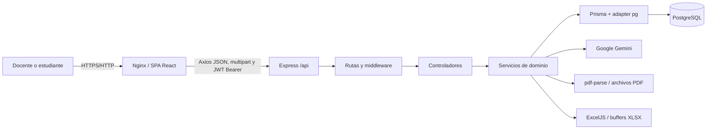

# Informe integral de EvaluaIA

**Fecha de revisión estática:** 13 de octubre de 2026  
**Alcance:** árbol de trabajo local, incluidos archivos modificados y no rastreados.  
**Método:** lectura del código, configuración, esquema y migraciones. No se modificaron datos, no se ejecutaron migraciones, no se instalaron dependencias y no se llamó a Gemini ni a PostgreSQL.

## 1. Resumen ejecutivo

EvaluaIA es una aplicación web de evaluación educativa para secundaria. Separa los usuarios en docentes y estudiantes. El docente crea cursos, matricula alumnos, administra planes curriculares, construye y publica evaluaciones y consulta resultados agregados. El estudiante accede a cursos y evaluaciones publicadas, conserva un único intento por evaluación, recibe calificación automática, consulta progreso y puede generar una práctica adaptativa basada en resultados previos.

La solución usa React 19 y Vite en el navegador; Express 5 en una API REST; Prisma 7 con PostgreSQL; JWT y bcrypt para identidad; Gemini mediante `@google/genai`; `pdf-parse` para PDF; ExcelJS y Multer para importación Excel; Docker Compose y Nginx para despliegue. La organización backend sigue `routes → controllers → services → Prisma`, con validadores y middleware transversales.

El núcleo de evaluaciones está implementado con evidencia estática significativa: control de propiedad, ocultación de soluciones, intento único, corrección, transacciones, progreso por tema y analítica. No se verificó dinámicamente contra base de datos o Gemini. Tres endpoints genéricos (`/matriculas`, `/preguntas` y un controlador de usuarios no registrado) son simulados. El README enumera como “en desarrollo” varias funciones que el código actual ya implementa, por lo que no debe usarse como única fuente del estado.

Los riesgos principales son: detalle de curso accesible a estudiantes sin comprobar matrícula y con datos de terceros; autorregistro público como docente; rutas simuladas sin autenticación; ausencia de unicidad de respuesta por intento/pregunta; secretos y credenciales de desarrollo con valores predeterminados; JWT en `localStorage`; PDF persistido dentro del contenedor sin volumen; posible creación concurrente duplicada de respuestas; y carencia de pruebas automatizadas.

## 2. Propósito y alcance funcional

El README declara que el sistema busca reducir trabajo manual, mejorar seguimiento, mostrar rendimiento y entregar retroalimentación adaptativa. Los usuarios son:

- **Docente:** crea cursos y evaluaciones, administra matrícula, plan curricular y preguntas; consulta estudiantes, resultados y analítica.
- **Estudiante:** se registra, inicia sesión, consulta cursos, resuelve una evaluación una vez, revisa resultados/progreso y solicita prácticas adaptativas.

No existe rol de administrador, institución ni apoderado. Tampoco se encontró recuperación de contraseña, verificación de correo, cierre/revocación de tokens, auditoría de acciones o gestión institucional. La efectividad educativa no puede inferirse del software: no hay resultados experimentales ni validación pedagógica en el repositorio.

## 3. Arquitectura general

El frontend es una SPA. `ProtectedRoute` comprueba token y rol almacenados localmente; esto mejora navegación, pero la seguridad efectiva depende del backend. Axios añade `Authorization: Bearer` y, ante 401 fuera de login/registro, borra sesión y redirige.

El backend registra `/api`, CORS con `CORS_ORIGIN`, JSON y manejadores globales 404/error. Las rutas aplican JWT y roles de forma selectiva. Los controladores convierten identificadores y delegan en servicios. Los servicios aplican propiedad/matrícula y realizan consultas/transacciones Prisma.

## 4. Tecnologías comprobadas

| Capa | Tecnología | Uso |
|---|---|---|
| Frontend | React 19, React DOM | UI por componentes y estado local |
| Navegación | React Router DOM 7 | Rutas públicas y protegidas por rol |
| Cliente HTTP | Axios | API, interceptores y JWT |
| Build | Vite 8 | Desarrollo y bundle |
| Estilo | CSS y CSS Modules | Diseño por componente |
| Backend | Node.js, Express 5 CommonJS | API REST |
| ORM | Prisma 7, `@prisma/adapter-pg` | Modelado y acceso PostgreSQL |
| Seguridad | bcryptjs, jsonwebtoken | Hash de contraseña y JWT |
| IA | `@google/genai` | Gemini con respuesta JSON |
| Documentos | pdf-parse, Multer | Extracción y carga PDF |
| Excel | ExcelJS, Multer | Plantilla e importación en memoria |
| Infraestructura | Docker, Compose, Nginx | PostgreSQL, API y SPA |

## 5. Módulos del repositorio

- `frontend/src/routes`: definición de rutas y páginas públicas/docente/estudiante.
- `frontend/src/services`: contratos Axios para autenticación, cursos, evaluaciones, intentos, IA, perfil, progreso, prácticas y plan curricular.
- `frontend/src/components` y `layouts`: botones, tarjetas, modales, cabeceras, navegación y shell autenticado.
- `backend/src/routes`: endpoints REST y middleware por ruta.
- `backend/src/controllers`: adaptación HTTP, parseo de IDs y forma de respuesta.
- `backend/src/services`: reglas de negocio, IA, calificación, analítica, PDF, Excel y persistencia.
- `backend/src/validators`: validación manual de cuerpos.
- `backend/src/middlewares`: JWT, roles, errores, 404 y carga de archivos.
- `backend/prisma`: esquema, migraciones y seed.
- `backend/scripts`: verificación manual, pruebas de Gemini/plan y entrypoint Docker.

## 6. Autenticación, autorización y sesión

`POST /api/auth/registro` valida nombre, correo con expresión regular, contraseña mínima de seis caracteres y rol. `auth.service` comprueba correo único, aplica bcrypt con diez rondas y crea `Usuario`. No entrega token tras registro. `POST /login` busca por correo, compara hash y firma JWT con `id`, `correo`, `rol`, `JWT_SECRET` y expiración configurable.

`auth.middleware` exige esquema exacto `Bearer`, verifica firma/expiración y copia las claims a `req.usuario`. No vuelve a consultar el usuario: un cambio de rol o eliminación no se refleja hasta que el token expire. `role.middleware` aplica lista de roles. Las comprobaciones de propiedad se implementan en servicios, principalmente por `docenteId`, y las de estudiante por `Matricula`.

En frontend el token y usuario se guardan en `localStorage`. No hay refresh token, lista de revocación, cookie HttpOnly, MFA ni expiración proactiva. `ProtectedRoute` confía en el rol local para la UI, aunque el backend vuelve a autorizar las operaciones importantes.

## 7. Lógica educativa

### 7.1 Calificación

`intentos.service.finalizar` recorre todas las preguntas. El puntaje máximo es la suma de `Pregunta.puntaje`; el obtenido suma el puntaje completo de cada respuesta correcta. No existe crédito parcial.

`porcentaje = round((puntajeTotal / puntajeMaximo) × 100, 2)`; si el máximo es cero, devuelve 0. La nota en escala vigesimal usada en reportes es `round((porcentaje / 5) × 10) / 10`.

- Opción múltiple/verdadero-falso: correcta si la alternativa seleccionada pertenece a la pregunta y `esCorrecta=true`.
- Respuesta corta: igualdad exacta después de quitar tildes, convertir a minúsculas, recortar y colapsar espacios.
- Sin respuesta: se crea una `RespuestaEstudiante` incorrecta con cero puntos.

**Ejemplo:** preguntas de 2, 1 y 2 puntos; acierta la primera y tercera: 4/5 = 80%, nota 16.0/20. El nivel es `INTERMEDIO`, pues avanzado exige estrictamente más de 80.

### 7.2 Niveles y dominio

`adaptiveLearningService.determinarNivel` usa:

- `< 55`: `BASICO`.
- `55 ≤ porcentaje ≤ 80`: `INTERMEDIO`.
- `> 80`: `AVANZADO`.
- Tema dominado: porcentaje de dominio `≥ 80`.

Existe una inconsistencia: la función local `nivelPorPorcentaje` de `intentos.service` usa 50 como inicio de `INTERMEDIO`, mientras el servicio adaptativo usa 55. Así, un resultado de 52% puede guardarse como `nivelObtenido=INTERMEDIO` pero mostrarse en progreso como `BASICO`.

### 7.3 Progreso

Después de finalizar una evaluación regular, el servicio agrupa las respuestas por tema y subtema. Para cada tema calcula `aciertos / total × 100`, determina nivel y hace `upsert` de `ProgresoEstudiante` por `(estudianteId, cursoId, tema)`. El valor representa el último procesamiento de ese tema, no un promedio histórico acumulado. El progreso global sí promedia porcentajes de intentos finalizados.

### 7.4 Recomendaciones y prácticas adaptativas

Las recomendaciones base son deterministas:

- Básico: repaso guiado de temas con errores.
- Intermedio: consolidación de temas por reforzar.
- Avanzado: retos contextualizados sobre temas dominados.

El estudiante necesita una evaluación formal finalizada. La práctica toma el último porcentaje del curso, errores por tema y progresos. Usa `<55`, `55–80`, `>80` para dificultad básica/intermedia/avanzada, selecciona hasta tres temas y pide cinco preguntas a Gemini. Si Gemini falla, crea preguntas plantilla genéricas. La evaluación resultante se publica y se restringe mediante `estudianteObjetivoId`. El fallback garantiza flujo técnico, pero su contenido es pedagógicamente simulado.

## 8. Inteligencia artificial y PDF

`aiService` usa `@google/genai`. La clave se lee de `GEMINI_API_KEY`; no se documenta su valor. El modelo principal se configura con `GEMINI_MODEL`; Compose propone `gemini-2.5-flash-lite`. Los fallbacks se leen de `GEMINI_FALLBACK_MODELS`; se configuraron reintentos y espera exponencial mediante `GEMINI_RETRY_MAX` y `GEMINI_RETRY_BASE_MS`.

Las llamadas piden JSON y limpian cercos Markdown antes de `JSON.parse`. Se validan tipos, alternativas, una única correcta, dificultad, puntaje, retroalimentación y estructura curricular. Se distinguen fallos de configuración, cuota/429, disponibilidad y formato. No se comprobó una llamada externa.

Usos reales en código:

1. Borrador de preguntas para docente: no persiste automáticamente.
2. Retroalimentación de un intento: comprueba propietario estudiante o docente del curso y guarda JSON en `IntentoEvaluacion.retroalimentacionIA`.
3. Estructura curricular desde PDF: extrae hasta el límite configurado y reemplaza unidades/temas/subtemas con confirmación.
4. Preguntas de práctica adaptativa: si falla, usa fallback local.

Los datos enviados pueden incluir nombre/grado del curso, temas, subtemas, preguntas falladas, porcentaje y resultados. No se observó envío deliberado de nombre o correo del estudiante en los prompts revisados. Esto debe confirmarse con política de privacidad y términos del proveedor antes de usar datos reales.

Los PDF se validan por MIME/extensión y tamaño, se almacenan bajo `uploads/planes-curriculares/<cursoId>`, se extrae texto seleccionable y se rechazan documentos con texto insuficiente. No hay OCR. El procesamiento puede truncar el texto y lo comunica en metadatos.

## 9. Base de datos: síntesis

Hay 13 modelos: `Usuario`, `Curso`, `Matricula`, `Evaluacion`, `Pregunta`, `Alternativa`, `IntentoEvaluacion`, `RespuestaEstudiante`, `ProgresoEstudiante`, `PracticaAdaptativa`, `PlanCurricular`, `UnidadCurricular`, `TemaCurricular`, `SubtemaCurricular` (14 contando todos los declarados). Las uniones muchos-a-muchos se materializan con `Matricula`.

Restricciones principales: correo único; matrícula única estudiante/curso; intento único estudiante/evaluación; progreso único estudiante/curso/tema; práctica única por evaluación. Faltan restricciones para una respuesta única por intento/pregunta, orden único dentro de unidades/temas y coherencia de roles en relaciones.

Las cascadas eliminan matrícula al borrar curso, evaluaciones/preguntas/intentos relacionados, progreso, prácticas y estructura curricular. Varias relaciones a `Usuario` conservan `RESTRICT` implícito. Temas/subtemas referenciados por evaluación usan `SET NULL`.

Las migraciones registran la evolución inicial, perfil, retroalimentación IA, práctica adaptativa, intento único y plan curricular. El esquema actual incluye campos de enlace curricular en `Evaluacion`; debe compararse cuidadosamente con la última migración antes de desplegar. No se ejecutó `prisma migrate status`, por requerir conexión.

## 10. Seguridad: hallazgos principales

| Prioridad | Hallazgo | Evidencia e impacto | Recomendación |
|---|---|---|---|
| Crítica | Acceso horizontal al detalle de curso | `cursos.controller.detalle` llama `obtenerDetalle(cursoId)` para cualquier no-docente; no verifica matrícula y devuelve alumnos/correos/evaluaciones | Exigir matrícula y crear DTO reducido de estudiante |
| Alta | Autorregistro como docente | Validador público acepta `DOCENTE` | Invitación, aprobación o administración institucional |
| Alta | Rutas públicas simuladas | `GET /api/matriculas` y `/api/preguntas` no tienen JWT | Eliminar o autenticar antes de implementar |
| Alta | Secreto JWT y DB con defaults | Compose incluye fallback de desarrollo y credenciales conocidas | Fallar al arrancar sin secretos; secretos externos |
| Alta | Respuestas concurrentes duplicables | No hay `@@unique([intentoId,preguntaId])`; `findFirst` seguido de create | Restricción única y `upsert` |
| Alta | PDF no persistente en Compose | `uploads` no tiene volumen y DB guarda ruta absoluta | Volumen/objeto externo y política de borrado |
| Media | JWT en localStorage | Un XSS podría exfiltrarlo | Cookie HttpOnly/SameSite o CSP rigurosa |
| Media | Rol tomado del token | No se consulta usuario en cada solicitud | Claims cortas, revocación o consulta de estado |
| Media | Registro/login sin rate limiting | Rutas públicas permiten abuso | Rate limit, bloqueo progresivo y observabilidad |
| Media | Errores 500 exponen mensaje | `errorHandler` devuelve `err.message` incluso en 500 | Mensaje genérico y registro interno con ID |
| Media | Fecha límite no se exige al iniciar/finalizar | Se almacena pero el flujo revisado no bloquea por vencimiento | Aplicar regla explícita y pruebas |
| Media | Evaluación publicada editable/eliminable | Servicio no impide mutar con intentos | Máquina de estados y política de inmutabilidad |

Estos hallazgos son estáticos. No se intentó explotación. CORS limita orígenes del navegador, pero no sustituye autorización. El filtro de PDF usa MIME/extensión, no firma mágica del archivo.

## 11. API REST consolidada

Todos los endpoints parten de `/api`.

| Método | Endpoint | Autenticación/rol | Función y estado |
|---|---|---|---|
| GET | `/health` | Pública | Salud; implementada |
| POST | `/auth/registro` | Pública | Crear usuario; implementada |
| POST | `/auth/login` | Pública | JWT; implementada |
| GET | `/auth/perfil` | JWT | Usuario sanitizado; implementada |
| GET | `/usuarios/:id/perfil` | JWT + reglas de servicio | Perfil acotado; implementada |
| POST | `/cursos` | JWT DOCENTE | Crear curso propio; implementada |
| GET | `/cursos/mis-cursos` | JWT | Listado por rol; implementada |
| GET | `/cursos/:id/estudiantes/plantilla` | JWT DOCENTE + propietario | Descargar XLSX; implementada, no verificada E2E |
| POST | `/cursos/:id/estudiantes/importar` | JWT DOCENTE + propietario | Crear/matricular lote; implementada, no verificada E2E |
| GET | `/cursos/:id/resumen-estudiantes` | JWT DOCENTE + propietario | Rendimiento; implementada |
| POST | `/cursos/:id/plan-curricular` | JWT DOCENTE + propietario | Subir PDF; implementada |
| GET | `/cursos/:id/plan-curricular` | JWT + propiedad/matrícula | Listar planes; implementada |
| GET | `/cursos/:id` | JWT | Detalle; implementada con riesgo de acceso |
| POST | `/cursos/:id/matriculas` | JWT DOCENTE + propietario | Matricular cuenta existente |
| DELETE | `/cursos/:id/matriculas/:estudianteId` | JWT DOCENTE + propietario | Quitar matrícula |
| GET | `/matriculas` | Pública | Simulada; devuelve vacío |
| POST | `/evaluaciones` | JWT DOCENTE + propietario curso | Crear evaluación |
| GET | `/evaluaciones/curso/:cursoId` | JWT + propiedad/matrícula | Listar según rol |
| POST | `/evaluaciones/:id/preguntas` | JWT DOCENTE + propietario | Agregar pregunta |
| POST | `/evaluaciones/:id/iniciar` | JWT ESTUDIANTE + matrícula | Crear/reanudar intento |
| PUT | `/evaluaciones/:id/publicar` | JWT DOCENTE + propietario | Publicar |
| GET | `/evaluaciones/:id/analitica` | JWT DOCENTE + propietario | Analítica agregada |
| GET | `/evaluaciones/:id` | JWT + reglas de servicio | Detalle, soluciones ocultas |
| PUT | `/evaluaciones/:id` | JWT DOCENTE + propietario | Editar |
| DELETE | `/evaluaciones/:id` | JWT DOCENTE + propietario | Eliminar |
| GET | `/preguntas` | Pública | Simulada; devuelve vacío |
| POST | `/intentos/:intentoId/respuestas` | JWT ESTUDIANTE + dueño | Guardar respuesta |
| POST | `/intentos/:intentoId/finalizar` | JWT ESTUDIANTE + dueño | Calificar y cerrar |
| GET | `/intentos/:intentoId/resultados` | JWT + dueño/propietario | Resultado detallado |
| GET | `/progreso/mi-progreso` | JWT ESTUDIANTE | Progreso global/curso |
| GET | `/perfil` | JWT | Perfil y estadísticas |
| PUT | `/perfil` | JWT | Actualizar campos permitidos |
| POST | `/ia/generar-preguntas` | JWT DOCENTE | Borrador IA |
| POST | `/ia/generar-retroalimentacion` | JWT ambos + servicio | Generar/guardar feedback |
| POST | `/practicas-adaptativas/generar` | JWT ESTUDIANTE | Crear práctica personal |
| GET | `/plan-curricular/:planId` | JWT + propiedad/matrícula | Detalle |
| PUT | `/plan-curricular/:planId` | JWT DOCENTE + propietario | Editar plan/estructura |
| PUT | `/plan-curricular/:planId/publicar` | JWT DOCENTE + propietario | Publicar plan |
| POST | `/plan-curricular/:planId/procesar-pdf` | JWT DOCENTE + propietario | Extraer y estructurar con IA |
| POST | `/plan-curricular/:planId/unidades` | JWT DOCENTE + propietario | Crear unidad |
| PUT/DELETE | `/unidades-curriculares/:unidadId` | JWT DOCENTE + propietario | Editar/eliminar unidad |
| POST | `/unidades-curriculares/:unidadId/temas` | JWT DOCENTE + propietario | Crear tema |
| PUT/DELETE | `/temas-curriculares/:temaId` | JWT DOCENTE + propietario | Editar/eliminar tema |
| POST | `/temas-curriculares/:temaId/subtemas` | JWT DOCENTE + propietario | Crear subtema |
| PUT/DELETE | `/subtemas-curriculares/:subtemaId` | JWT DOCENTE + propietario | Editar/eliminar subtema |

## 12. Estado funcional

| Módulo | Funcionalidad | Estado | Limitación/prueba necesaria | Prioridad |
|---|---|---|---|---|
| Identidad | Registro/login/JWT | Implementada | Sin rate limit/verificación; E2E DB | Alta |
| Perfil | Consulta/edición/estadísticas | Implementada | Probar permisos cruzados | Media |
| Cursos | Crear/listar/detalle | Implementada | Corregir acceso estudiante | Crítica |
| Matrícula | Por correo/eliminación | Implementada | E2E y concurrencia | Alta |
| Excel | Plantilla/importación atómica | Implementada, no verificada E2E | Probar archivo real y rollback | Alta |
| Evaluaciones | Crear/editar/publicar/eliminar | Implementada | Reglas tras publicación | Alta |
| Preguntas | Tres tipos | Implementada dentro de evaluación | Sin edición/eliminación específica | Media |
| Intentos | Único/reanudable/finalizable | Implementada | Unicidad de respuestas | Alta |
| Calificación | Automática | Implementada | Inconsistencia umbral 50/55 | Alta |
| Progreso | Por tema/global | Implementada | Sustituye, no acumula histórico temático | Media |
| Adaptación | Recomendación/práctica | Parcial | IA o fallback genérico; validar pedagogía | Alta |
| Gemini | Preguntas/feedback/PDF | Implementada, no verificada externamente | Clave, cuota, red, calidad | Alta |
| Plan curricular | PDF/CRUD/publicación | Implementada, no verificada E2E | Sin OCR; persistencia archivo | Alta |
| Analítica docente | Resúmenes y evaluación | Implementada | Consultas N+1 y pruebas de escala | Media |
| `/matriculas`, `/preguntas` | Listados genéricos | Simulada | Eliminar o implementar | Alta |
| Pruebas | Scripts manuales | Parcial | No hay suite automatizada | Alta |

## 13. Calidad y pruebas

No se encontró Jest, Vitest, Supertest, Playwright o Cypress ni scripts `test`. Hay scripts manuales `verify-system.js`, `test-plan-curricular.js` y `test-gemini.js`; pueden requerir DB/API/clave y no se ejecutaron en esta auditoría. Frontend define `npm run lint` y `npm run build`; backend define `dev`, `start`, `seed`.

No se ejecutó ningún comando funcional en esta auditoría por la restricción expresa. La existencia de código se clasifica como implementación estática, no como prueba de operación. Los casos prioritarios están en `SEGURIDAD_Y_PRUEBAS.md`.

## 14. Ejecución y despliegue previsto

Desarrollo local: configurar `DATABASE_URL`, `JWT_SECRET`, `JWT_EXPIRES_IN`, `CORS_ORIGIN` y opcionalmente variables Gemini/PDF; generar Prisma/aplicar migraciones; iniciar backend con `npm run dev` y frontend con `npm run dev`. Estos pasos se deducen de scripts/configuración, no de una guía completa verificada.

Compose levanta PostgreSQL 16 Alpine, backend Node 22 Alpine y frontend compilado servido por Nginx. El entrypoint aplica `prisma migrate deploy`, ejecuta seed si `RUN_SEED=true` e inicia Node. Nginx soporta fallback SPA y gzip. La base tiene volumen; los PDF no. No se encontraron backup, TLS, monitoreo, healthcheck de backend/frontend, logging estructurado ni estrategia de rollback.

## 15. Plan de mejora

### Antes de una demostración académica

1. Corregir acceso de estudiante a detalle de curso.
2. Deshabilitar endpoints simulados públicos.
3. Unificar umbral 50/55 y documentar 80 inclusivo/exclusivo.
4. Probar un flujo completo docente-estudiante con base limpia.
5. Actualizar README y preparar contingencia si Gemini falla.

### Antes de un piloto con estudiantes reales

1. Alta de docentes controlada y consentimiento/privacidad.
2. Restricción única de respuestas y pruebas concurrentes.
3. Persistencia segura de PDF, backups y borrado.
4. Rate limiting, secreto obligatorio, TLS y sesiones más seguras.
5. Suite de integración para permisos, intento, calificación e importación.
6. Validación pedagógica del fallback y de contenido Gemini.

### Para producción

1. Gestión institucional, auditoría y observabilidad.
2. Almacenamiento de objetos, cifrado, retención y recuperación.
3. CI/CD, escaneo de dependencias, pruebas E2E/carga y rollback.
4. Alta disponibilidad y configuración por entorno.
5. Accesibilidad, privacidad formal y evaluación de impacto de IA.

## 16. Aspectos que requieren confirmación del autor

- Institución, población exacta y alcance experimental de la tesis.
- Política oficial para crear docentes y cuentas de alumnos.
- Significado pedagógico aprobado de 55%, 80% y nota 11/20.
- Si progreso debe representar último intento o promedio histórico.
- Política de fecha límite, edición después de publicar y conservación de historial.
- Base legal/consentimiento para enviar información educativa a Gemini.
- Entorno real de despliegue, dominio, TLS, backups y soporte.
- Resultados de validación con expertos o estudiantes; no existen en el código.
